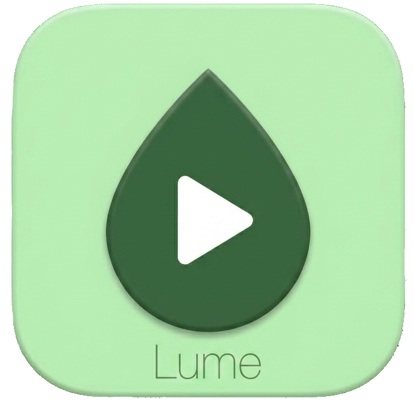

# 🎵 Lume

<div align="center">
  
  <p><strong>Reproductor de música moderno, elegante e inteligente para Android</strong></p>

  <p>
    
    
    
    
    
  </p>
</div>

---

## 🌟 Descripción General

**Lume** es un reproductor de música local para Android diseñado desde cero con **Jetpack Compose** y **AndroidX Media3**. Combina una estética minimalista y moderna con herramientas avanzadas como sincronización interactiva de letras (LRC), análisis estadístico de escucha y un motor de huellas acústicas (Audio Fingerprinting) basado en FFT.

---

## ✨ Características Principales

### 🎨 Diseño y Experiencia de Usuario
- **Tema Dinámico Adaptativo:** Los colores de fondo y acento se extraen dinámicamente de la carátula de cada canción mediante algoritmos de paleta de color y gradientes animados.
- **Diseño Moderno:**
  - **Modo Vertical:** Carátula cuadrada con esquinas pronunciadas o vista alternativa en forma de silueta orgánica (blob).
  - **Modo Horizontal (Landscape):** Relación de aspecto panorámica 16:9 con controles optimizados para uso en coche o sobre mesa.
- **Microinteracciones y Gestos:** Desliza hacia abajo para minimizar el reproductor, desliza horizontalmente para cambiar de pista.
- **MiniPlayer con Glassmorphism:** Barra flotante minimalista con indicador de reproducción y controles rápidos.

### 🎶 Reproducción y Sonido
- **Motor Media3 ExoPlayer:** Reproducción local de baja latencia con soporte para formatos FLAC, MP3, AAC, OGG, WAV, M4A, etc.
- **Servicio en Segundo Plano:** `PlaybackService` con integración completa de `MediaSession`, controles de notificación y bloqueo de pantalla.
- **Smart Shuffle (Aleatorio Inteligente):** Reproducción aleatoria inteligente que pondera tus canciones favoritas y frecuencias de escucha sin repetir canciones seguidas.
- **Selector de Velocidad:** Ajusta el tempo de reproducción desde `0.5x` hasta `2.0x`.

### 📜 Letras Sincronizadas e Interactivas (LRC)
- **Sincronización en Tiempo Real:** Detección precisa de la línea activa con escala, opacidad y resalte de acento.
- **Salto Táctil (Seek on Click):** Toca cualquier verso para mover la reproducción a ese segundo exacto.
- **Desplazamiento Automático Suave:** Centrado automático continuo de la letra en pantalla.
- **Mini Overlay de Letras:** Indicador flotante del verso actual sobre la carátula del álbum en la vista principal.

### 🔤 Navegación Rápida A-Z (Alphabet Fast Scroller)
- Tira alfabética lateral (`A-Z + #`) con respuesta háptica integrada.
- Detección precisa según el orden por artista y burbuja flotante indicadora para saltar instantáneamente en colecciones grandes.

### 📊 Panel de Estadísticas (`StatsScreen`)
- **Tiempo Total de Escucha:** Conteo en tiempo real acumulado de tus horas y minutos de música.
- **Género y Artista Favorito:** Métricas automáticas basadas en tu historial real de escucha.
- **Gráfica de Actividad por Hora:** Visualización de tus momentos del día con mayor actividad e identificación de tu hora pico.
- **Top 10 de Canciones y Artistas:** Filtros por período: *Semanal*, *Mensual* y *Historial Completo*.
- **Exportación e Importación:** Exporta tu biblioteca completa y estadísticas a JSON o importa archivos de letras sincronizadas con opciones de fusión o reemplazo.

### 🎙️ Procesador de Audio y Huellas Acústicas (`AudioProcessorScreen`)
- **Algoritmo FFT Propietario (`AudioFingerprinter`):** Remuestreo a 11,025 Hz, paso de banda y extracción de constelaciones espectrales para generar huellas resistentes al ruido.
- **Exportación de Huellas de Biblioteca:** Generación de archivos JSON con huellas acústicas (`hash` y `offset_ms`) listas para indexar en bases de datos o backends (Go/PostgreSQL).
- **Grabación y Reconocimiento con Micrófono:** Captura audio ambiental durante 10 segundos, calcula sus frecuencias y permite exportar la consulta para reconocimiento de canciones.

---

## 🛠️ Arquitectura y Tecnologías

Lume está estructurado siguiendo las directrices modernas de desarrollo en Android:

- **UI:** [Jetpack Compose](https://developer.android.com/jetpack/compose) con [Material 3](https://m3.material.io/).
- **Arquitectura:** MVVM (Model-View-ViewModel) con Kotlin Coroutines y `StateFlow`.
- **Reproducción:** [AndroidX Media3 ExoPlayer](https://developer.android.com/guide/topics/media/media3) + `MediaSessionService`.
- **Persistencia Local:** [Room Database](https://developer.android.com/training/data-storage/room) con SQLite para canciones, carpetas, listas de reproducción y letras sincronizadas.
- **Almacenamiento y Archivos:** Storage Access Framework (SAF) para escaneo y lectura sin requerir permisos invasivos de almacenamiento completo.
- **Procesamiento de Señales:** Transformada Rápida de Fourier (FFT) en Kotlin para extracción de huellas de audio.

```
com.example.lume/
├── data/                  # Entidades Room, DAOs y Repositorio de Datos
│   ├── AppDatabase.kt
│   ├── LyricsEntity.kt & LyricsDao.kt
│   ├── TrackEntity.kt & TrackDao.kt
│   └── MusicRepository.kt
├── services/              # Servicios de reproducción y tareas en segundo plano
│   ├── PlaybackService.kt
│   ├── SmartShuffleService.kt
│   └── FingerprintExportService.kt
├── ui/                    # Pantallas, componentes y tema Compose
│   ├── MainScreen.kt
│   ├── PlayerScreen.kt
│   ├── StatsScreen.kt
│   ├── AudioProcessorScreen.kt
│   ├── AlphabetFastScroller.kt
│   └── TrackCover.kt & TrackRow.kt
└── util/                  # Utilidades y procesamiento de audio
    ├── AudioFingerprinter.kt
    ├── SongIdGenerator.kt
    └── Debouncer.kt
```

---

## 📋 Requisitos de Sistema

| Requisito | Versión Mínima |
|-----------|----------------|
| **Sistema Operativo** | Android 8.1 Oreo (API 27+) |
| **Objetivo / Target SDK** | Android 16 (API 36) |
| **Java / JDK** | JDK 11 o superior |
| **Gradle** | 8.x |

---

## 🚀 Compilación e Instalación

Para compilar el proyecto localmente mediante el terminal:

1. **Clonar el repositorio:**
   ```bash
   git clone https://github.com/tu-usuario/lume.git
   cd lume
   ```

2. **Compilar el APK de depuración (Debug):**
   ```bash
   ./gradlew assembleDebug
   ```

3. **Instalar en un dispositivo o emulador conectado:**
   ```bash
   ./gradlew installDebug
   ```

---

## 📄 Licencia

Este proyecto se distribuye bajo los términos de la licencia detallada en el archivo [LICENSE](LICENSE).
