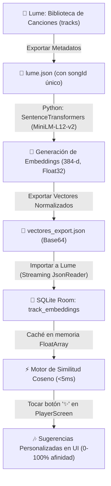
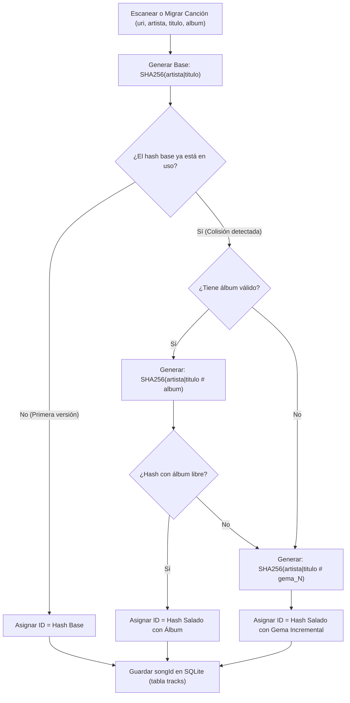

# 🧠 Sugerencias Inteligentes y Búsqueda Vectorial en Lume (v5.0)

A partir de la **versión 5.0** (Database Schema v5), **Lume** incorpora un motor semántico de **Sugerencias Inteligentes de Canciones** basado en embeddings vectoriales y similitud coseno en el dispositivo. Esta funcionalidad permite descubrir afinidades musicales entre canciones según sus metadatos (título, artista, álbum, género, compositor) de forma local, rápida (<5 ms) y privada.

---

## 📐 Arquitectura General del Sistema

El flujo completo combina la exportación de metadatos desde la app Android, el cálculo de embeddings densos de alta dimensión mediante NLP (SentenceTransformers), y la búsqueda e importación de vectores optimizada para dispositivos móviles:

---

## 🔍 ¿Cómo Funciona la Funcionalidad?

### 1. Modelo de Embeddings
Se utiliza el modelo **`sentence-transformers/paraphrase-multilingual-MiniLM-L12-v2`**:
- **Dimensiones:** 384 dimensiones.
- **Tipo de dato:** `float32`, little-endian.
- **Normalización L2:** Activada (`normalizado = true`).
- **Ventaja de la normalización:** Dado que los vectores tienen norma unitaria ($\|\mathbf{u}\| = 1$), la **similitud coseno** equivale exactamente al **producto punto** ($\mathbf{u} \cdot \mathbf{v}$), reduciendo la complejidad del cálculo a multiplicaciones y sumas vectoriales inmediatas sin requerir raíces cuadradas.

### 2. Exportación de Metadatos (`StatsScreen.kt`)
Desde la pantalla de estadísticas, el usuario puede pulsar **"Exportar Metadatos (JSON)"**:
- Se genera un documento JSON con todas las canciones de la biblioteca.
- Cada entrada contiene su `id` único (`track.songId`), título, artista, álbum, género, duración, año, compositor, formato y reproducciones.

### 3. Procesamiento Externo en Python
El script de Python procesa `lume.json`:
1. Normaliza los textos con Unicode NFC.
2. Agrupa los campos de metadatos formateados como:
   `"Título: ... | Artista: ... | Álbum: ... | Género: ..."`
3. Codifica los textos en batches de 32 mediante `model.encode(normalize_embeddings=True)`.
4. Convierte cada array de `float32` a bytes binarios y los serializa en **Base64**.
5. Produce `vectores_export.json`.

### 4. Importación con Cero Carga de Memoria (`VectorSearchManager.kt`)
Para evitar que archivos JSON grandes (10-50 MB) causen errores `OutOfMemoryError` en Android:
- **Streaming directo con `android.util.JsonReader`:** No se convierte el JSON a `String` ni a árboles `JSONObject`. Se lee flujo a flujo directamente desde el `InputStream` del URI de SAF.
- **Decodificación directa:** La cadena Base64 se decodifica en un `ByteArray` de $384 \times 4 = 1536$ bytes y se inserta por lotes (batches de 200) en Room.
- **Opciones de importación:**
  1. **Actualizar vectores existentes:** `REPLACE_EXISTING` (actualiza los existentes e inserta los nuevos).
  2. **Insertar solo los nuevos:** `INSERT_NEW_ONLY` (omite los ya presentes y solo añade los faltantes).
- **Liberación de recursos:** Al finalizar la importación, se vacían las estructuras temporales y se fuerza la recolección de basura con `System.gc()`.

### 5. Interfaz de Usuario en el Reproductor (`PlayerScreen.kt`)
- En la barra de utilidades del reproductor se muestra el botón **"✨"**.
- Si la canción actual tiene vector disponible, el icono se ilumina en color acento.
- Al pulsarlo, se despliega un **ModalBottomSheet** moderno que muestra:
  - Lista de hasta 15 canciones con mayor similitud semántica.
  - Puntuación visual con porcentaje de afinidad (ej. *94% afinidad*).
  - Reproducción directa: al tocar cualquier sugerencia, la cola se reconfigura para continuar reproduciendo a partir de esa recomendación.

---

## 🛠️ La Solución al Problema de Colisiones: Identificador Determinístico con Sal ("Gema")

### El Problema Previo
En bibliotecas reales, es común tener múltiples archivos para una misma canción:
- Versión original de estudio vs. Versión en vivo (Live).
- Versiones Remix, Acústicas, Instrumental o Reedición/Remaster.
- Pistas presentes en diferentes álbumes (álbum original vs. recopilatorio "Greatest Hits").

Anteriormente, el ID se calculaba únicamente como `SHA256(artista | titulo)`. Esto provocaba que:
1. Todas las versiones recibieran el **mismo ID**.
2. En `lume.json`, los registros colisionaban.
3. En la tabla SQLite `track_embeddings` (donde `songId` es la Primary Key), solo sobrevivía un único vector.
4. Al intentar buscar sugerencias para una de las versiones, la consulta podía fallar o referenciar la versión equivocada.

### La Solución Implementada: Opción 1 (Persistencia de `songId` + Sal/Gema)

#### Componentes Clave:

1. **`SongIdGenerator.generateWithSalt(artist, title, salt)`**:
   Concatena de forma limpia `normalize(artist) + "|" + normalize(title) + "#" + cleanSalt` y genera los primeros 16 caracteres hexadecimales mediante SHA-256.

2. **`SongIdGenerator.assignUniqueSongIds(tracks, existingUsedIds)`**:
   - Evalúa cada pista.
   - Si la pista ya posee un `songId` válido y sin colisión, lo conserva intacto.
   - Si es nueva o colisiona, calcula el hash base. Si ya existe en la biblioteca, intenta usar el álbum como sal ("gema"). Si el álbum también coincide o no existe, aplica una gema numérica determinística incremental (`gema_2`, `gema_3`, etc.).

3. **Migración de Base de Datos `MIGRATION_4_5` en AppDatabase.kt**:
   - Eleva la versión del esquema de base de datos a **5**.
   - Ejecuta `ALTER TABLE tracks ADD COLUMN songId TEXT NOT NULL DEFAULT ''`.
   - Lee todos los registros existentes en la tabla `tracks`, calcula y asigna los IDs únicos resolviendo todas las colisiones sin destruir ninguna canción ni favoritos de los usuarios.

4. **Búsqueda Resiliente en VectorSearchManager.kt**:
   `getCandidateIdsForTrack` establece el siguiente orden jerárquico de coincidencia:
   - **Prioridad 0:** `track.songId` persistido en la base de datos (identificación exacta 1:1 de versiones y gemas).
   - **Prioridad 1:** Coincidencia exacta `artista|titulo`.
   - **Prioridad 2:** Sal por álbum conocido `artista|titulo#album`.
   - **Prioridad 3-7:** Variantes resilientes (sin paréntesis, sin número de pista, sin prefijos de artista "feat.", y nombres de archivo).

---

## 📈 Resumen de Archivos Modificados

| Archivo | Rol en la Implementación |
|---|---|
| `data/TrackEntity.kt` | Se agregó la columna `val songId: String = ""` a la entidad Room. |
| `MainActivity.kt` | Modelo `Track`, escaneo de carpetas y agregación asignando `songId` único. |
| `data/AppDatabase.kt` | Versión 5 y `MIGRATION_4_5` para actualizar la tabla `tracks`. |
| `data/MusicRepository.kt` | Mapeo bidireccional de `songId` entre `Track` y `TrackEntity`. |
| `util/SongIdGenerator.kt` | Algoritmo con sal `generateWithSalt` y asignador `assignUniqueSongIds`. |
| `ui/StatsScreen.kt` | Exportación de `lume.json` con los `songId` únicos. |
| `data/VectorSearchManager.kt` | Motor de búsqueda vectorial y candidato prioritario `track.songId`. |
| `ui/PlayerScreen.kt` | UI con botón "✨" y panel inferior de sugerencias inteligentes. |
