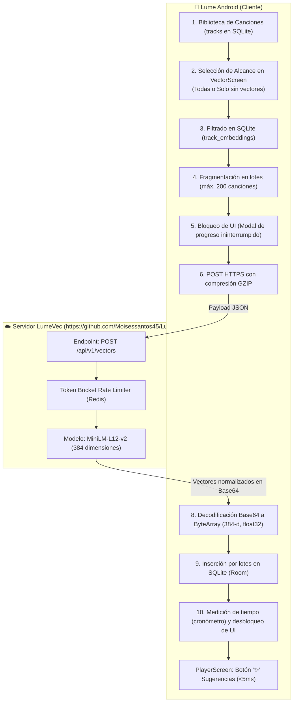

# 🧠 Sugerencias Inteligentes y Búsqueda Vectorial en Lume (v5.0+)

A partir de la **versión 5.0** (Database Schema v5), **Lume** incorpora un motor semántico de **Sugerencias Inteligentes de Canciones** basado en embeddings vectoriales y similitud coseno en el dispositivo. 

El sistema admite dos modalidades operativas:
1. **Modo Nube (API REST):** Vectorización directa y sin fricción mediante la API de alto rendimiento conectada a `https://lumevec.mmabitec.uk`.
2. **Modo Offline / Archivo Local:** Exportación de `lume.json`, cálculo batch offline con script de Python e importación directa en streaming (`vectores_export.json`).

> [!NOTE]
> Toda la información sobre el código fuente, despliegue, configuración de FastAPI, Redis, PyTorch CPU y puesta en marcha del servidor se encuentra en su propio repositorio oficial:  
> 🔗 **[GitHub: Moisessantos45/LumeVec](https://github.com/Moisessantos45/LumeVec)**

---

## 📐 Arquitectura y Flujo de la Funcionalidad

El proceso de vectorización en la app sigue un flujo optimizado, modular y tolerante a fallos:



---

## 🚀 Proceso y Flujo de Vectorización con la API

### 1. Comprobación Previa de Estado (`Health Check`)
Al ingresar a la pantalla de vectores (`VectorScreen.kt`), la app verifica de forma no bloqueante el estado del servidor ejecutando un `GET /health`. Si responde exitosamente, se muestra la píldora informativa:
`🟢 API en línea (lumevec.mmabitec.uk)`.

### 2. Selección del Alcance de Canciones
La interfaz permite elegir qué canciones enviar al servidor:
- **"Todas las canciones":**
  - Envía la totalidad de las pistas de la biblioteca.
  - Muestra el selector de guardado: *"Actualizar todo"* (`REPLACE_EXISTING`) o *"Solo los nuevos"* (`INSERT_NEW_ONLY`).
  - Ideal para la primera vez o si la base de datos de vectores está vacía.
- **"Solo canciones sin vectores":**
  - Consulta la tabla `track_embeddings` en SQLite para extraer los IDs ya vectorizados y filtra la lista en memoria en milisegundos.
  - Si no hay canciones pendientes, avisa al usuario sin realizar peticiones HTTP innecesarias.
  - **Ocultamiento inteligente:** Oculta automáticamente el selector de modo de guardado con animación colapsable, asignando directamente el modo `INSERT_NEW_ONLY`.

### 3. Particionado en Lotes (Chunking)
Para respetar el límite estricto de 250 canciones por petición del servidor y prevenir sobrecargas de memoria o red:
- La app divide las canciones en lotes de **200 canciones**.
- Cada canción se serializa con su identificador único persistido (`songId`), título, artista, álbum, género y compositor.

### 4. Bloqueo Resiliente de la Interfaz
- Mientras la vectorización está en curso, se despliega un diálogo modal que bloquea la interacción del usuario (`DialogProperties(dismissOnBackPress = false, dismissOnClickOutside = false)`).
- Muestra el progreso en tiempo real: *"Enviando lote X de Y (A / B canciones)..."*.
- **Tolerancia a fallos:** Si ocurre un error de conexión, tiempo de espera agotado o límite de tasa (código HTTP 429), la interfaz se desbloquea de inmediato y de forma garantizada (`finally { isProcessing = false }`), mostrando el mensaje de error en el Snackbar.

### 5. Decodificación e Inserción Local
- La respuesta HTTP JSON contiene los vectores serializados en Base64.
- `VectorSearchManager` decodifica la cadena Base64 directamente a un `ByteArray` de $384 \times 4 = 1536$ bytes, sin pasos intermedios innecesarios.
- Los vectores se insertan en batches de 200 en la tabla `track_embeddings` mediante Room.
- Se invalida la caché en memoria para que el reproductor reconozca inmediatamente los nuevos vectores.

### 6. Cronómetro y Medición del Tiempo
- Al concluir todo el proceso, se calcula el tiempo transcurrido desde el inicio de la petición hasta el guardado final en SQLite:
  - Se muestra una tarjeta con el tiempo exacto: `⏱️ Tiempo de respuesta API: X.XX s (XXXX ms)`.
  - El `Snackbar` confirma la cantidad de vectores procesados y la duración.

---

## 🔒 Configuración de la URL de la API en Tiempo de Compilación

A diferencia de Flutter (donde se utiliza `--dart-define-from-file`), en **Android con Kotlin (Gradle)** se utiliza **`BuildConfig`**:

### 1. Configuración en `app/build.gradle.kts`:
```kotlin
android {
    defaultConfig {
        val vectorApiUrl = (project.findProperty("VECTOR_API_URL") as? String)
            ?: System.getenv("VECTOR_API_URL")
            ?: "https://lumevec.mmabitec.uk"

        buildConfigField("String", "VECTOR_API_URL", "\"$vectorApiUrl\"")
    }

    buildFeatures {
        compose = true
        buildConfig = true
    }
}
```

### 2. Formas de modificar la URL en compilación:
- **Por parámetro de Gradle:**
  ```bash
  ./gradlew assembleDebug -PVECTOR_API_URL="https://otro-servidor.com"
  ```
- **Por variable de entorno:**
  ```bash
  export VECTOR_API_URL="https://otro-servidor.com" && ./gradlew assembleDebug
  ```
- **Por archivo local:** Añadiendo `VECTOR_API_URL=https://otro-servidor.com` en `local.properties` (ignorado en Git).
- En el código Kotlin se consume directamente mediante `BuildConfig.VECTOR_API_URL`.

---

## 🛠️ Resolución de Duplicados en Canciones: Sal / Gema Determinística (Opción 1)

Para evitar colisiones entre versiones distintas de la misma canción (original vs en vivo, remixes o pistas con igual artista y título):
1. **`SongIdGenerator.generateWithSalt(artist, title, salt)`**: Combina `artista|titulo#sal` en SHA-256 devolviendo los primeros 16 caracteres hexadecimales.
2. **Asignación:**
   - La primera versión obtiene el hash base determinístico (`artista|titulo`).
   - Si otra canción comparte artista y título, se utiliza el nombre del álbum (`album`) como sal.
   - Si el álbum coincide o no existe, se añade una sal numérica incremental (`gema_2`, `gema_3`, etc.).
3. **Persistencia en SQLite (Room v5):**
   - La columna `songId` se persiste en la tabla `tracks` mediante `MIGRATION_4_5`.
   - La app y la API se comunican mediante ese mismo `songId`, garantizando correspondencia 1:1.
